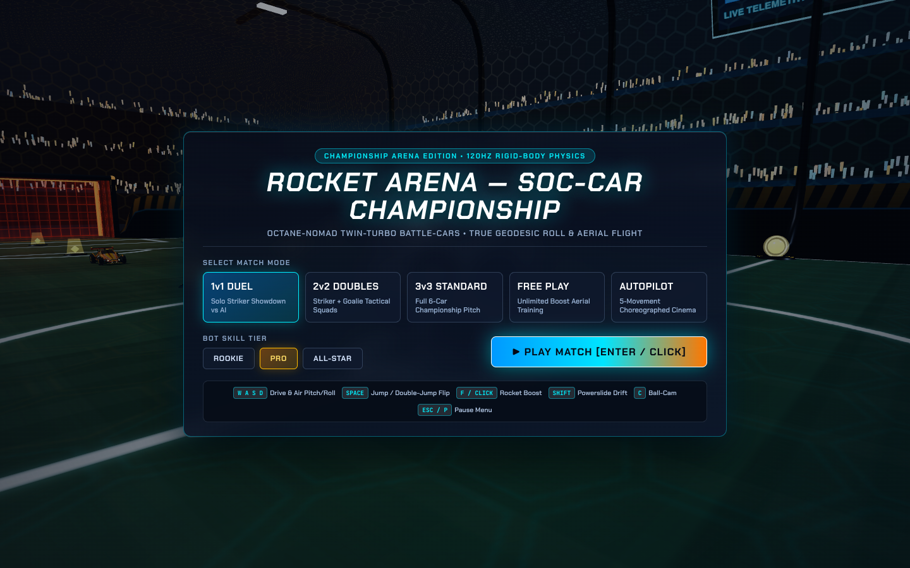

# Rocket Arena

**Rocket Arena** es un juego de fútbol de coches en 3D que se ejecuta
directamente en el navegador. Compite en partidos, practica libremente o
contempla enfrentamientos automáticos en un estadio 3D.

El proyecto utiliza **Three.js 0.160.0** y **WebGL2**, con físicas
propias, vehículos y pelota 3D, inteligencia artificial, efectos
visuales, audio procedural y diferentes modos de juego.



  -----------------------------------------------------------------------
  Vista del vehículo                  Acción en el estadio
  ----------------------------------- -----------------------------------
        Neo-Dome](docs/action_m1.png)

  -----------------------------------------------------------------------

## Características

-   Partidos **1 contra 1** y **2 contra 2**.
-   Modo de juego libre (*Free Play*).
-   Exhibición automática con vehículos controlados por IA.
-   Estadio 3D DFH Neo-Dome con porterías, superficies curvas y
    plataformas de impulso.
-   Vehículo Octane-RLX y pelota 3D.
-   Física de conducción, suspensión, saltos, giros, derrapes y
    propulsión.
-   Conducción por el suelo, las paredes curvas y el techo de la arena.
-   Transiciones redondeadas en las porterías; la conducción completa desde
    la rampa interior hasta el techo y la salida sobre el larguero sigue
    pendiente de verificación jugable.
-   Cámara Ball-Cam y Car-Cam.
-   Repeticiones de gol con historial temporal e interpolación.
-   Bots con distintos niveles de dificultad.
-   Efectos de partículas, explosiones y audio procedural.
-   Compatibilidad con teclado, ratón y mandos compatibles con Gamepad
    API.
-   Controles táctiles en dispositivos compatibles.

## Requisitos

-   Navegador moderno compatible con **WebGL2**.
-   Aceleración gráfica por hardware recomendada.
-   Conexión a Internet para cargar Three.js y las fuentes externas.

> El juego no requiere un servidor de backend. Sin embargo, Three.js y
> algunos recursos externos se cargan desde servicios CDN, por lo que se
> necesita conexión a Internet para iniciar el juego.

## Cómo ejecutar el juego

### Ejecutar en local (recomendado)

Los módulos JavaScript del proyecto se cargan como módulos ES. Para evitar
restricciones del navegador al abrir archivos `file://`, sirve la carpeta
por HTTP. Con Python instalado, ejecuta desde la raíz:

```bash
python3 -m http.server 8000
```

Después visita `http://localhost:8000`.

También puedes usar cualquier servidor estático local. No se necesita un
backend del juego, pero sí conexión a Internet para descargar Three.js desde
jsDelivr y las fuentes externas.

### Compilar la versión independiente

Con Python instalado, abre una terminal en la carpeta del proyecto y
ejecuta:

``` bash
python3 -m http.server 8000
```

Después visita `http://localhost:8000`.

## Controles

  Tecla o entrada             Acción
  --------------------------- -------------------------------------------------------
  `W` `A` `S` `D` o flechas   Acelerar, retroceder y girar
  `Espacio`                   Saltar, realizar doble salto o impulso direccional
  `F` o clic izquierdo        Activar propulsión (*boost*)
  Clic derecho                Saltar o realizar una acción de salto contextual
  `Shift`                     Derrapar o controlar el giro aéreo
  `I` / `K`                   Inclinar el vehículo hacia delante o atrás en el aire
  `Q` / `E`                   Girar el vehículo en el aire
  `C`                         Cambiar entre Ball-Cam y Car-Cam
  `Esc` o `P`                 Abrir o cerrar el menú de pausa
  `Tab`                       Mostrar u ocultar el panel Director/Mutator
  `1` a `5`                   Activar secuencias de movimiento y demostraciones
  `0`                         Iniciar la exhibición automática
  `R`                         Reiniciar la salida
  `M`                         Silenciar o activar el audio

### Mandos

Los mandos compatibles se detectan mediante Gamepad API. La asignación
concreta puede variar según el modelo del mando y el navegador. En
dispositivos táctiles compatibles se muestran controles en pantalla.

## Estructura del proyecto

``` text
Rocket-Arena/
├── index.html
├── README.md
├── dist/
│   └── app-bundle.js
├── docs/
│   ├── start_screen.png
│   ├── front_34.png
│   └── action_m1.png
├── scripts/
│   └── bundle_index.py
├── music/
└── src/
    ├── arena-and-environment.js
    ├── main.js
    ├── match-results-screen.js
    ├── music-player.js
    ├── physics-and-kinematics.js
    ├── vehicles-and-ball.js
    └── vfx-audio-and-ui.js
```

## Arquitectura

-   **`src/arena-and-environment.js`**: construcción del estadio,
    superficies, texturas, porterías, plataformas de impulso y geometría
    del entorno.
-   **`src/vehicles-and-ball.js`**: modelos del vehículo y la pelota,
    materiales, texturas y componentes visuales.
-   **`src/physics-and-kinematics.js`**: simulación física, colisiones,
    suspensión, movimiento, pelota, bots y sistema de repeticiones.
-   **`src/vfx-audio-and-ui.js`**: cámaras, HUD, menús, partículas,
    efectos visuales y audio procedural.
-   **`src/music-player.js`** y **`src/match-results-screen.js`**: música y
    pantalla de resultados, respectivamente.
-   **`src/main.js`**: inicialización del juego, renderizado, bucle
    principal, controles y conexión entre los sistemas.
-   **`scripts/bundle_index.py`**: genera la versión independiente y
    actualiza el HTML independiente.

## Compilar después de modificar el código

Si modificas archivos dentro de `src/`, vuelve a generar el paquete y el
HTML ejecutando desde la carpeta raíz:

``` bash
python3 scripts/bundle_index.py
```

El script genera `dist/app-bundle.js` y una versión independiente en
`index.html`. La página del repositorio ejecuta los módulos de `src/`
directamente; para publicar un build independiente, ejecuta el script y
revisa ambos archivos generados.

## Audio y créditos

- **Driftway** — música de **-Xaf-** (artista identificado como HappyXaf en
  [Newgrounds](https://www.newgrounds.com/audio/listen/1636539)). La ficha
  ofrece la obra bajo [Creative Commons Attribution 3.0 (CC BY 3.0)](https://creativecommons.org/licenses/by/3.0/).
  Se debe conservar este crédito y la licencia al redistribuir la pista.
- **Midnight Dream** — música de **Saavane**, con procedencia reportada desde
  [Pixabay](https://pixabay.com/users/saavane-32312792/). Pixabay permite
  usar sus contenidos sujetos a su [Content License](https://pixabay.com/service/license-summary/)
  y recomienda aunque no exige atribución. No he podido localizar la ficha
  específica de esta pista; conserva la URL o comprobante de descarga original
  para acreditar que este archivo concreto procede de Pixabay y se descargó
  bajo esa licencia. No distribuyas el archivo de audio por separado.

La licencia MIT del repositorio cubre el código y la documentación del
proyecto, no concede por sí misma derechos sobre estas pistas ni sobre otros
recursos de terceros.

## Estado y limitaciones conocidas

Rocket Arena es un juego independiente de fútbol de coches. No está
afiliado, patrocinado ni respaldado por los titulares de marcas o
videojuegos de terceros. La compatibilidad entre navegadores, mandos y
controles táctiles, así como el rendimiento y la conducción en las rampas
interiores de las porterías, deben verificarse en los dispositivos objetivo.
