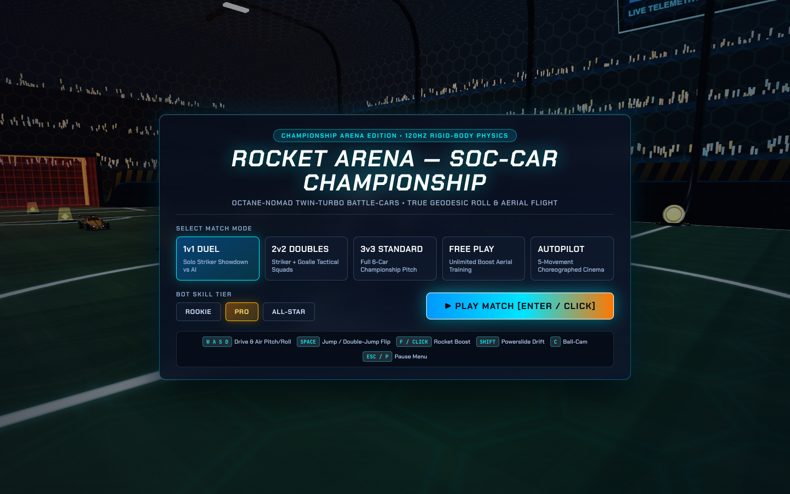

# Rocket Arena

**Rocket Arena** es un juego de fútbol de coches en 3D que se ejecuta
directamente en el navegador. Compite en partidos, practica libremente o
contempla enfrentamientos automáticos en un estadio 3D.

El proyecto utiliza **Three.js 0.160.0** y **WebGL2**, con físicas
propias, vehículos y pelota 3D, inteligencia artificial, efectos
visuales, audio procedural y diferentes modos de juego.



  -----------------------------------------------------------------------
  Vista del vehículo                  Acción en el estadio
  ----------------------------------- -----------------------------------
        Neo-Dome](docs/action_m1.png)

  -----------------------------------------------------------------------

## Características

-   Partidos **1 contra 1** y **2 contra 2**.
-   Modo de juego libre (*Free Play*).
-   Exhibición automática con vehículos controlados por IA.
-   Estadio 3D DFH Neo-Dome con porterías, superficies curvas y
    plataformas de impulso.
-   Vehículo Octane-RLX y pelota 3D.
-   Física de conducción, suspensión, saltos, giros, derrapes y
    propulsión.
-   Conducción por suelo, paredes curvas y techo.
-   Cámara Ball-Cam y Car-Cam.
-   Repeticiones de gol con historial temporal e interpolación.
-   Bots con distintos niveles de dificultad.
-   Efectos de partículas, explosiones y audio procedural.
-   Compatibilidad con teclado, ratón y mandos compatibles con Gamepad
    API.
-   Controles táctiles en dispositivos compatibles.

## Requisitos

-   Navegador moderno compatible con **WebGL2**.
-   Aceleración gráfica por hardware recomendada.
-   Conexión a Internet para cargar Three.js y las fuentes externas.

> El juego no requiere un servidor de backend. Sin embargo, Three.js y
> algunos recursos externos se cargan desde servicios CDN, por lo que se
> necesita conexión a Internet para iniciar el juego.

## Cómo ejecutar el juego

### Opción 1: abrir el archivo

Abre `index.html` directamente con un navegador moderno. Si el navegador
o la configuración local impiden cargar algún recurso, utiliza un
servidor HTTP local.

### Opción 2: servidor local

Con Python instalado, abre una terminal en la carpeta del proyecto y
ejecuta:

``` bash
python3 -m http.server 8000
```

Después visita `http://localhost:8000`.

## Controles

  Tecla o entrada             Acción
  --------------------------- -------------------------------------------------------
  `W` `A` `S` `D` o flechas   Acelerar, retroceder y girar
  `Espacio`                   Saltar, realizar doble salto o impulso direccional
  `F` o clic izquierdo        Activar propulsión (*boost*)
  Clic derecho                Saltar o realizar una acción de salto contextual
  `Shift`                     Derrapar o controlar el giro aéreo
  `I` / `K`                   Inclinar el vehículo hacia delante o atrás en el aire
  `Q` / `E`                   Girar el vehículo en el aire
  `C`                         Cambiar entre Ball-Cam y Car-Cam
  `Esc` o `P`                 Abrir o cerrar el menú de pausa
  `Tab`                       Mostrar u ocultar el panel Director/Mutator
  `1` a `5`                   Activar secuencias de movimiento y demostraciones
  `0`                         Iniciar la exhibición automática
  `R`                         Reiniciar la salida
  `M`                         Silenciar o activar el audio

### Mandos

Los mandos compatibles se detectan mediante Gamepad API. La asignación
concreta puede variar según el modelo del mando y el navegador. En
dispositivos táctiles compatibles se muestran controles en pantalla.

## Estructura del proyecto

``` text
Rocket-Arena/
├── index.html
├── README.md
├── CHANGELOG.md
├── dist/
│   └── app-bundle.js
├── docs/
│   ├── start_screen.png
│   ├── front_34.png
│   └── action_m1.png
├── scripts/
│   └── bundle_index.py
└── src/
    ├── arena-and-environment.js
    ├── main.js
    ├── physics-and-kinematics.js
    ├── vehicles-and-ball.js
    └── vfx-audio-and-ui.js
```

## Arquitectura

-   **`src/arena-and-environment.js`**: construcción del estadio,
    superficies, texturas, porterías, plataformas de impulso y geometría
    del entorno.
-   **`src/vehicles-and-ball.js`**: modelos del vehículo y la pelota,
    materiales, texturas y componentes visuales.
-   **`src/physics-and-kinematics.js`**: simulación física, colisiones,
    suspensión, movimiento, pelota, bots y sistema de repeticiones.
-   **`src/vfx-audio-and-ui.js`**: cámaras, HUD, menús, partículas,
    efectos visuales y audio procedural.
-   **`src/main.js`**: inicialización del juego, renderizado, bucle
    principal, controles y conexión entre los sistemas.
-   **`scripts/bundle_index.py`**: genera el paquete JavaScript y
    actualiza el HTML independiente.

## Compilar después de modificar el código

Si modificas archivos dentro de `src/`, vuelve a generar el paquete y el
HTML ejecutando desde la carpeta raíz:

``` bash
python3 scripts/bundle_index.py
```

El script actualiza `dist/app-bundle.js` e integra el código en
`index.html`.

## Mejoras técnicas de esta versión

-   Corregida la proyección del punto de contacto entre el coche y la
    pelota en el eje Z.
-   Simulación física con acumulador de paso fijo a **120 Hz**,
    independiente de la frecuencia de pantalla.
-   Repeticiones de gol con seis segundos de historial temporal e
    interpolación entre muestras.
-   Eliminada la línea de tiempo de repetición duplicada.
-   Suavizado visual del vehículo usando el delta real del fotograma.
-   Actualización del público limitada para reducir el trabajo de CPU y
    las transferencias a GPU.
-   Evitadas subidas redundantes de búferes de partículas y marcas de
    derrape cuando no hay elementos activos.
-   Ajustes del renderizador para reducir el coste de memoria y adaptar
    la resolución a la pantalla.
-   Añadidos controles mediante Gamepad API y controles táctiles
    compatibles.
-   Evitadas activaciones repetidas de acciones de teclado que solo
    deben ejecutarse una vez.
-   Mejorados el zoom de página y los nombres accesibles de los
    controles deslizantes.

## Estado y limitaciones conocidas

El proyecto ha pasado comprobaciones estáticas de sintaxis y
compilación. El rendimiento gráfico, la compatibilidad entre
navegadores, los mandos y los controles táctiles deben verificarse en
los dispositivos de destino.

Rocket Arena es un proyecto independiente de fútbol de coches. No está
afiliado, patrocinado ni respaldado por los titulares de marcas o
videojuegos de terceros.
